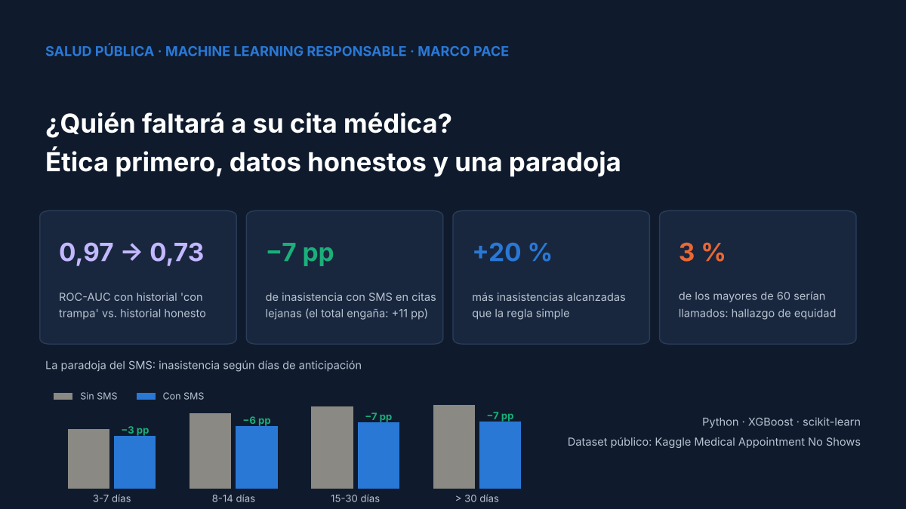
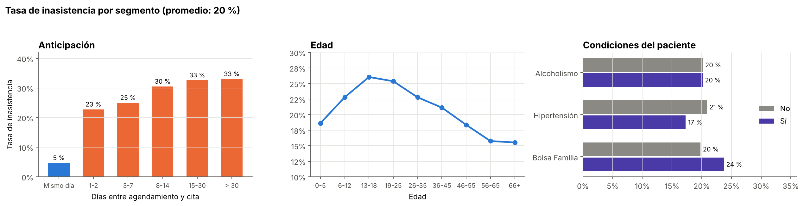
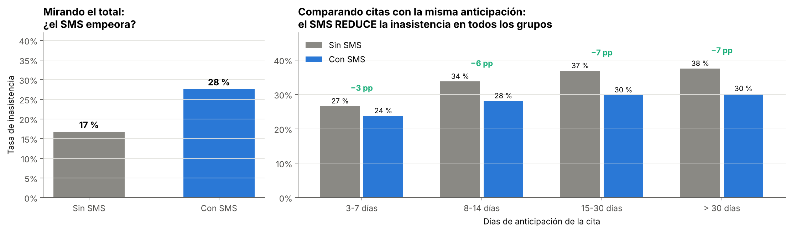
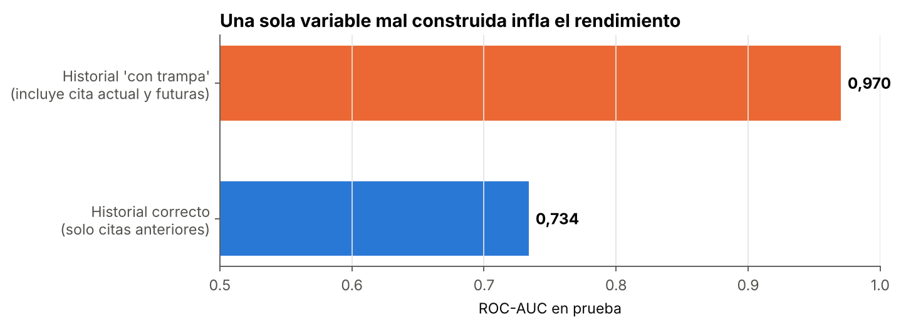
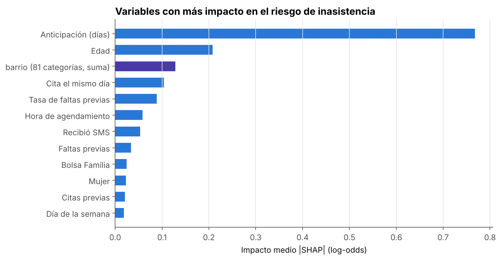
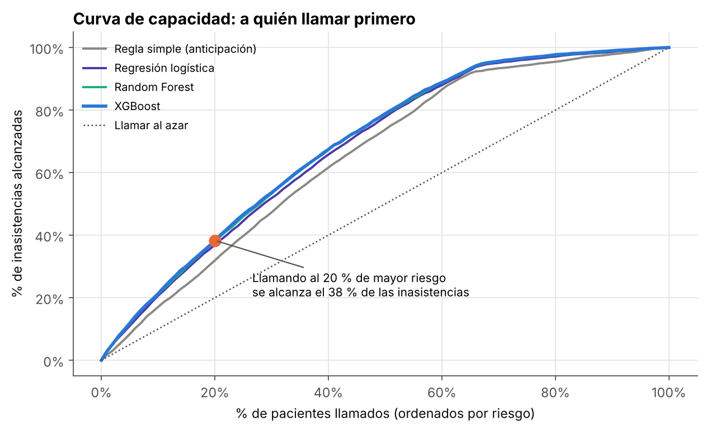
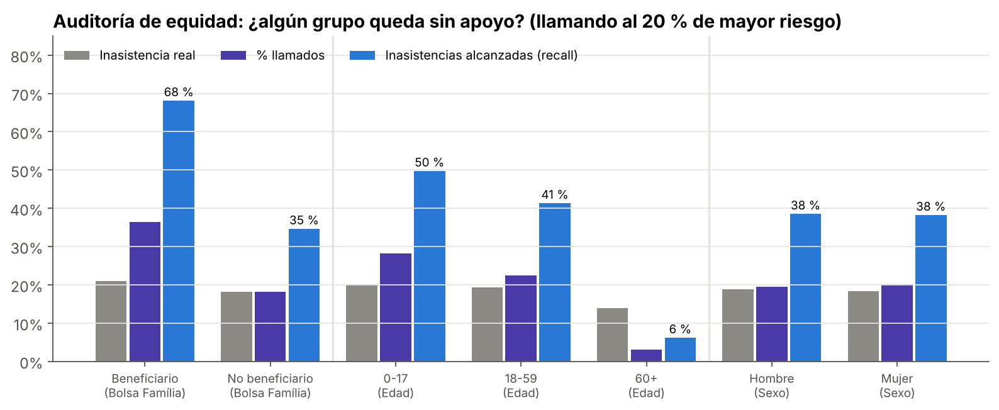

# 🏥 Inasistencia a citas médicas: Machine Learning responsable con el marco PACE

> **El mismo modelo puede ayudar o discriminar según cómo se use.** Proyecto integral (Planificar → Analizar → Construir → Ejecutar) que reformula un pedido éticamente problemático, desmonta una paradoja en los datos, evita una fuga de información que inflaba el ROC-AUC de 0,73 a 0,97 y convierte el modelo en una política de apoyo a pacientes.




---

## 🅿️ Planificar: el pedido y su reformulación ética

**Pedido original:** *"Identificar a los pacientes que no van a asistir para **sobreagendar** sus horas."*

| Error del modelo | Consecuencia si se usa para sobreagendar |
|---|---|
| Falso positivo (predice que falta, pero asiste) | El paciente llega y su hora está ocupada |
| Falso negativo (predice que asiste, pero falta) | Se pierde la hora (el problema actual) |

El riesgo es mayor en **jóvenes, beneficiarios de programas sociales y citas lejanas**. Sobreagendar traspasaría el costo de la inasistencia a los pacientes más vulnerables.

**Objetivo reformulado:** *identificar a quién **ofrecer apoyo*** (llamada de confirmación, facilidad para reagendar). Un falso positivo pasa a costar una llamada innecesaria. **Regla de uso:** el puntaje nunca se usa para negar, retrasar ni castigar una cita.

## 📊 Resultados principales

| Indicador | Resultado |
|---|---|
| ROC-AUC con historial "con trampa" vs. historial honesto | **0,970 → 0,734** |
| Efecto del SMS al comparar citas con la misma anticipación | **−3 a −7 puntos** de inasistencia (aunque el total muestra +11 puntos) |
| Inasistencias alcanzadas llamando al 20 % de mayor riesgo | **38 %** con XGBoost vs. 32 % con la regla simple (**+20 %**) |
| Impacto en la semana de prueba | ~**310 pacientes más** alcanzados con la misma cantidad de llamadas |
| Hallazgo de equidad | Los mayores de 60 años serían llamados solo el **3 %** de las veces |

## 🅰️ Analizar

### Auditoría
`isna()` reporta cero faltantes, pero hay **5 citas agendadas después de ocurrir** y **1 edad negativa** (se eliminan). `AppointmentDay` no trae hora, y `Handicap` va de 0 a 4 (cantidad de discapacidades, no un error).

### Hallazgos



- **La anticipación domina:** las citas del mismo día casi no se pierden (5 %); desde 2 semanas de anticipación, 1 de cada 3 se pierde.
- Los **jóvenes de 13 a 25 años** faltan más y los **adultos mayores**, menos.
- Los beneficiarios de **Bolsa Família** faltan más (24 % vs. 20 %): el grupo que el pedido original habría perjudicado.

### 🔍 La paradoja del SMS



Mirando el total, quienes reciben SMS faltan **más** (28 % vs. 17 %). Pero **el SMS nunca se envía a citas con menos de 3 días de anticipación**, que son las de menor riesgo. Comparando citas con la misma anticipación, **el SMS reduce la inasistencia en todos los grupos**. Es una **paradoja de Simpson**: la anticipación confunde la relación.

**Lección:** la importancia de una variable en un modelo predictivo **no es un efecto causal**. "Dejar de enviar SMS" sería una decisión equivocada. Para medir el efecto real haría falta un experimento A/B.

## 🅲 Construir

### Una variable "con trampa"
Muchos notebooks crean "cuántas veces faltó el paciente" contando **todas** sus citas, incluida la actual y las futuras. Es fuga de información:



La versión correcta cuenta **solo las citas anteriores** a la fecha de la cita actual. Es el mismo principio que calcular promedios solo con los datos de entrenamiento.

### Validación temporal y modelos
Entrenamiento: 29-abr → 19-may · Validación: 20-may → 31-may (early stopping) · Prueba: 1-jun → 8-jun.

| Modelo | ROC-AUC | PR-AUC | Inasistencias alcanzadas (top 20 %) | Precisión (top 20 %) |
|---|---|---|---|---|
| Regla simple (anticipación) | 0,691 | 0,285 | 31,9 % | 29,4 % |
| Regresión logística | 0,726 | 0,337 | 36,9 % | 34,0 % |
| Random Forest | 0,735 | 0,349 | 37,9 % | 35,0 % |
| **XGBoost** ⭐ | **0,737** | **0,352** | **38,3 %** | **35,3 %** |

*Con 20 % de inasistencia, predecir "todos asisten" ya acierta el 80 %: por eso la métrica clave es cuántas inasistencias se alcanzan con la capacidad de llamadas disponible.*



## 🅴 Ejecutar

### A quién llamar primero



### Auditoría de equidad



- **Beneficiarios de Bolsa Família:** reciben el doble de llamadas (36 % vs. 18 %). Con el objetivo reformulado, eso es **focalización de apoyo**. Con el objetivo original, habría sido el doble de riesgo de llegar y no ser atendido: **el mismo modelo, con otro uso, sería discriminatorio**.
- **Hombres y mujeres:** trato prácticamente idéntico.
- ⚠️ **Mayores de 60:** casi no son llamados (3 %), aunque una cita perdida de un paciente crónico puede tener mayor costo clínico. Se recomienda reservarles una cuota de llamadas.

## 📋 Resumen ejecutivo

1. **No usar el modelo para sobreagendar** ni penalizar pacientes.
2. **Llamar al 20 % de citas de mayor riesgo** el día anterior, ofreciendo reagendar o liberar la hora.
3. **Reservar una cuota de llamadas** para adultos mayores y pacientes crónicos.
4. **Mantener y extender el SMS**, también a citas de 1-2 días, y medir su efecto con un **experimento A/B**.
5. **Ofrecer más citas con poca anticipación**, el formato con menor inasistencia.

## 🗂️ Estructura del repositorio

```
medical-no-show-pace/
├── data/                        # Dataset (no versionado, ver data/README.md)
├── images/                      # Gráficos generados por el notebook
├── notebooks/
│   └── analisis_inasistencia_citas_pace.ipynb
├── reports/
│   ├── comparacion_modelos.csv
│   ├── paradoja_sms.csv
│   ├── auditoria_equidad.csv
│   └── modelo_xgboost_inasistencia.joblib
├── requirements.txt
├── LICENSE
└── README.md
```

## ▶️ Cómo reproducirlo

```bash
git clone https://github.com/Cristobal-111/medical-no-show-pace.git
cd medical-no-show-pace
pip install -r requirements.txt
# Descarga KaggleV2-May-2016.csv desde Kaggle y cópialo en data/
jupyter notebook notebooks/analisis_inasistencia_citas_pace.ipynb
```

En Google Colab: [](https://colab.research.google.com/github/Cristobal-111/medical-no-show-pace/blob/main/notebooks/analisis_inasistencia_citas_pace.ipynb) (sube `KaggleV2-May-2016.csv` al panel de archivos antes de ejecutar). La ejecución completa toma menos de un minuto.

## ⚠️ Limitaciones

- Solo 6 semanas de citas: el historial de los pacientes es corto y no hay estacionalidad.
- La inasistencia depende de factores ausentes en los datos (transporte, trabajo, síntomas), lo que limita el rendimiento de cualquier modelo.
- El efecto de una llamada es un supuesto que debe validarse con un piloto.

## 📚 Fuente de datos

[Medical Appointment No Shows — Kaggle](https://www.kaggle.com/datasets/joniarroba/noshowappointments) · 110.527 citas del sistema público de salud de Vitória, Espírito Santo (Brasil), 2016.

## 🔗 Serie de proyectos

1. 📉 [Fuga de clientes en telecomunicaciones · Árbol de decisión](https://github.com/Cristobal-111/churn-prediction-telco)
2. 🏨 [Cancelaciones hoteleras · Random Forest](https://github.com/Cristobal-111/hotel-cancellation-random-forest)
3. 💳 [Riesgo de crédito · XGBoost](https://github.com/Cristobal-111/credit-risk-xgboost)
4. 🏥 **Inasistencia a citas médicas · Proyecto integral PACE** (este repositorio)

## 👤 Autor

**Cristobal Rojas** · Analista de Datos
[LinkedIn](https://www.linkedin.com/in/cristobal-rojas-troncoso/) · [GitHub](https://github.com/Cristobal-111)
